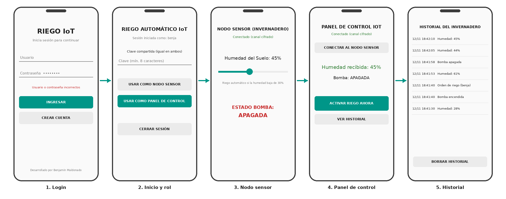

# Riego IoT

**Autor:** Benjamín Maldonado
**Asignatura:** TI3042 – Aplicaciones Móviles Android (Unidad 2)

Aplicación Android de mi sistema de riego automático de plantas. Dos teléfonos hacen de dispositivos IoT conectados por Bluetooth: uno simula el invernadero (sensor de humedad y bomba) y el otro es el panel donde el usuario inicia sesión, monitorea y ordena el riego.

El detalle completo de la problemática, las decisiones técnicas, el mockup, la seguridad y las pruebas está en **[docs/INFORME.md](docs/INFORME.md)**.



## Qué hace

- **Login** con usuario y contraseña, guardados en SQLite (la contraseña nunca se guarda: solo un hash con sal). La cuenta se bloquea 60 s tras 5 intentos fallidos.
- **Nodo sensor:** varío la humedad con una barra y la app la envía al panel cada segundo. Si baja de 30 %, la bomba se enciende sola; también se enciende con una orden válida del panel.
- **Panel de control:** muestra la humedad y la bomba en vivo y tiene el botón para regar manualmente.
- **Historial:** guarda en SQLite la humedad, el estado de la bomba y las órdenes de riego, y se puede consultar y borrar.
- **Seguridad:** todo lo que viaja por Bluetooth va cifrado (AES-256-GCM).

## Herramientas

Android Studio, Kotlin, vistas XML y Activities. Solo uso APIs nativas de Android (`android.bluetooth`, `javax.crypto`, SQLite), sin librerías externas. Elegí SQLite porque el sistema tiene que funcionar sin internet y así las credenciales no salen del teléfono.

## Estructura

```
app/src/main/java/com/tuproyecto/smartirrigation/
├── ui/          LoginActivity, MainActivity, SensorNodeActivity,
│                UserDashboardActivity, HistoryActivity, BaseBluetoothActivity
├── connection/  BluetoothController
├── security/    SecurityUtils (AES-GCM, hash de contraseñas, protocolo), Session
└── data/        AppDatabase (SQLite)
```

## Cómo probarlo

1. Crear un proyecto en Android Studio (*Empty Views Activity*, minSdk 26 o superior) y copiar `app/src/main/` encima del proyecto. Si tu paquete es otro, cámbialo en los archivos. Revisa que el tema del manifest (`Theme.SmartIrrigation`) coincida con el de tu `themes.xml`.
2. Instalar la app en dos teléfonos Android (8.0 o superior) y emparejarlos en Ajustes > Bluetooth.
3. En cada teléfono, crear una cuenta o iniciar sesión.
4. Escribir la **misma clave compartida** en ambos (mínimo 8 caracteres).
5. Teléfono 1: "Usar como nodo sensor". Teléfono 2: "Usar como panel de control" → "Conectar al nodo sensor".
6. Probar: mover la humedad, bajarla de 30 %, regar desde el panel, ver el historial y usar claves distintas para comprobar que los mensajes se rechazan.

## Seguridad (ISO/IEC 27400)

| Práctica | Cómo la apliqué |
|---|---|
| Cifrado de credenciales | Hash PBKDF2-HMAC-SHA256 con sal aleatoria por usuario |
| Cifrado de datos | AES-256-GCM con IV distinto en cada mensaje |
| Integridad | GCM descarta mensajes alterados |
| Control de acceso | Login obligatorio, bloqueo por intentos, Bluetooth seguro con emparejamiento |
| Mensajes repetidos | Timestamp y nonce en cada mensaje |
| Datos locales | Consultas SQL parametrizadas y `allowBackup=false` |
| Permisos | Solo `BLUETOOTH_CONNECT` (y `BLUETOOTH` en Android 11 o inferior) |

## Limitaciones

Es un prototipo: la sal de PBKDF2 del canal Bluetooth es fija (en un sistema real sería aleatoria o usaría el Android Keystore), y la humedad y la bomba están simuladas por software.
