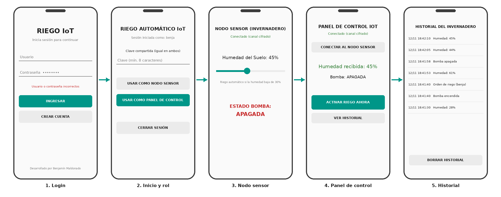
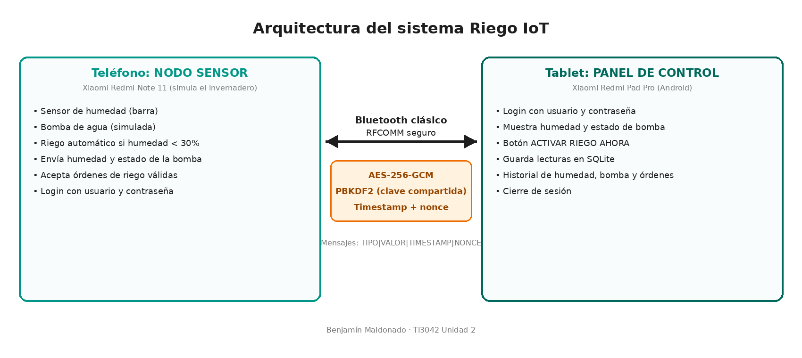

# Informe del proyecto: Riego IoT

**Autor:** Benjamín Maldonado
**Asignatura:** TI3042 – Aplicaciones Móviles Android, Unidad 2

---

## 1. Problemática y herramientas

### 1.1 Problemática

El riego de plantas depende de que una persona revise la humedad del suelo y active la bomba a mano. Si se olvida, las plantas se secan; si se pasa, se pudren. Además, quien administra el cultivo no siempre está junto a la bomba, y necesita ver cómo está el suelo y ordenar un riego sin perder el control sobre quién puede hacerlo.

**Dispositivos y sistemas a conectar**

| Dispositivo / sistema | Papel en el proyecto |
|---|---|
| Teléfono Xiaomi Redmi Note 11 (Android) – **nodo sensor** | Simula el invernadero: mide la humedad del suelo (con una barra que la varía) y controla la bomba de agua (simulada) |
| Tablet Xiaomi Redmi Pad Pro (Android) – **panel de control** | Es la aplicación del usuario o administrador: monitorea y envía órdenes |
| Canal Bluetooth entre ambos | Lleva los datos y las órdenes, cifrados |
| Base de datos SQLite en cada dispositivo | Guarda las cuentas de usuario y el historial de lecturas |

El nodo sensor informa la humedad y el estado de la bomba al panel, y el panel puede ordenarle un riego de forma segura, de modo que nadie sin autorización pueda activar la bomba.

### 1.2 Funcionalidades clave

| # | Funcionalidad | Tipo de interacción |
|---|---|---|
| F1 | Registro e inicio de sesión con usuario y contraseña | Autenticación |
| F2 | Elegir el rol del dispositivo (nodo sensor o panel) e ingresar la clave compartida | Configuración |
| F3 | Conexión Bluetooth entre ambos dispositivos | Conectividad |
| F4 | Monitoreo en vivo de la humedad y del estado de la bomba | Recibir datos |
| F5 | Riego automático cuando la humedad baja de 30 % | Control automático |
| F6 | Riego manual con el botón "Activar riego ahora" | Enviar órdenes |
| F7 | Historial de humedad, bomba y órdenes guardado en SQLite | Almacenamiento y consulta |
| F8 | Cifrado de todos los mensajes y protección de las cuentas | Seguridad |

### 1.3 Herramientas de desarrollo

| Necesidad | Herramienta | Razón de la elección |
|---|---|---|
| Entorno y lenguaje | Android Studio + Kotlin | Es el entorno oficial de Android y el lenguaje recomendado por Google |
| Interfaz | Vistas XML y Activities | Es el modelo estándar de Android y el que se trabajó en clases |
| Conectividad | API nativa `android.bluetooth` | No necesita librerías externas |
| Cifrado | `javax.crypto` (AES-GCM, PBKDF2) | Es el proveedor criptográfico estándar de Android |
| Autenticación y datos | **SQLite** (`SQLiteOpenHelper`) | Viene incluido en Android, funciona sin internet y es suficiente para este caso |
| Permisos | `ActivityResultContracts` | Es la forma actual de pedir permisos en tiempo de ejecución |

**Por qué SQLite y no Firebase o MySQL:** el invernadero y el usuario están cerca y el sistema debe funcionar aunque no haya internet. Firebase o una API con MySQL exigirían conexión permanente, un servidor que mantener y enviar credenciales por la red. Con SQLite las cuentas y los datos se quedan en el dispositivo y se consultan al instante. Los datos se intercambian en un formato de mensaje simple y documentado (`TIPO|VALOR|TIMESTAMP|NONCE`), que otro dispositivo podría interpretar.

---

## 2. Diseño de la solución

### 2.1 Método de comunicación inalámbrica

Elegí **Bluetooth clásico (RFCOMM)** tras comparar las opciones que plantea la guía:

| Criterio | Bluetooth | Wi-Fi | MQTT |
|---|---|---|---|
| **Distancia** | Unos 10 m, suficiente porque el invernadero y el usuario están cerca | Mayor alcance, pero depende de un router | Alcance de internet, con un servidor (broker) |
| **Consumo de energía** | Bajo | Más alto | Medio, más el consumo del Wi-Fi o los datos |
| **Estabilidad** | Conexión punto a punto directa, sin intermediarios | Depende de la red y del router | Depende de internet y del broker |
| **Infraestructura** | Ninguna | Router | Servidor y conexión permanente |
| **Seguridad inicial** | El emparejamiento ya exige aceptar el dispositivo | Depende de la red | Depende del broker |

Para dos dispositivos cercanos, Bluetooth es lo más simple, estable y económico en energía. Wi-Fi o MQTT tendrían sentido si el control fuera remoto, lo que excede el alcance de esta unidad.

### 2.2 Autenticación

De las tres opciones que da la guía elegí **SQLite local**:

| Criterio | SQLite (elegida) | Firebase Auth | API + MySQL |
|---|---|---|---|
| Seguridad | Hash PBKDF2 con sal por usuario; nada sale del dispositivo | Muy alta, gestionada por Google | Depende de cómo se programe el backend |
| Escalabilidad | Baja (un dispositivo) | Alta | Alta |
| Facilidad | Alta, sin servidores ni cuentas externas | Media | Baja (hay que montar y mantener el servidor) |
| Funciona sin internet | Sí | No | No |

El caso necesita funcionar sin internet y no requiere miles de usuarios. Si el proyecto creciera, el cambio natural sería Firebase Authentication.

**Cómo funciona el login:**
1. Al crear la cuenta, la app genera una sal aleatoria y guarda solo el hash PBKDF2 de la contraseña (nunca la contraseña).
2. Al ingresar, calcula el hash con la sal guardada y lo compara en tiempo constante.
3. Tras 5 intentos fallidos la cuenta se bloquea 60 segundos.
4. El mensaje de error es el mismo si el usuario no existe o la contraseña está mal, para no revelar qué usuarios existen.
5. La sesión vive solo en memoria; al cerrarla se borra también la clave de cifrado.

### 2.3 Mockup de la interfaz



**Navegación:** Login → Inicio y rol → (Nodo sensor **o** Panel de control) → Historial (solo desde el panel). Desde Inicio se puede cerrar sesión, lo que vuelve al login.

| Pantalla | Interacción con el IoT | Datos que muestra |
|---|---|---|
| 1. Login | Ninguna | Mensajes de error o éxito |
| 2. Inicio y rol | Define la clave compartida del canal cifrado | Usuario con sesión activa |
| 3. Nodo sensor | Varía la humedad; la bomba se enciende sola o por orden | Humedad, estado de la bomba, estado de la conexión |
| 4. Panel de control | Conecta al sensor y envía la orden de riego | Humedad en vivo (verde o rojo según el umbral), estado de la bomba |
| 5. Historial | Consulta de datos guardados | Fecha, hora y evento; opción de borrar |

**Arquitectura general:**



---

## 3. Construcción

### 3.1 Estructura del código

```
app/src/main/
├── AndroidManifest.xml
├── java/com/tuproyecto/smartirrigation/
│   ├── ui/          LoginActivity, MainActivity, SensorNodeActivity,
│   │                UserDashboardActivity, HistoryActivity, BaseBluetoothActivity
│   ├── connection/  BluetoothController (servidor, cliente y transferencia)
│   ├── security/    SecurityUtils (AES-GCM, hash de contraseñas, protocolo), Session
│   └── data/        AppDatabase (SQLite: usuarios y registros)
└── res/layout/      activity_login, activity_main, activity_sensor_node,
                     activity_user_dashboard, activity_history
```

La app está separada en cuatro capas (pantallas, conexión, seguridad y datos), de modo que cada archivo hace una sola cosa. Los parámetros del invernadero (umbral de humedad, duración de la bomba, incremento de humedad al regar e intervalo de envío) están como constantes al inicio de `SensorNodeActivity`. Las pantallas del sensor y del panel declaran `configChanges` en el manifest para que girar el dispositivo no destruya la pantalla ni corte la conexión.

### 3.2 Permisos

| Permiso | Para qué | Cuándo |
|---|---|---|
| `BLUETOOTH_CONNECT` | Conectarse a dispositivos emparejados y aceptar conexiones | Android 12 o superior; se pide en ejecución |
| `BLUETOOTH` | Lo mismo en versiones antiguas | Android 11 o inferior (`maxSdkVersion=30`) |

No se pide ubicación ni escaneo, porque la app se conecta a dispositivos ya emparejados (principio de mínimo privilegio). El manifest declara además `android.hardware.bluetooth` como requisito y `usesCleartextTraffic="false"`.

### 3.3 Seguridad según ISO/IEC 27400

| Práctica | Cómo la apliqué |
|---|---|
| Cifrado de credenciales | Contraseñas guardadas como hash PBKDF2-HMAC-SHA256 (120 000 iteraciones) con sal aleatoria por usuario |
| Cifrado de datos sensibles | Todos los mensajes Bluetooth con AES-256-GCM e IV aleatorio por mensaje |
| Integridad | La etiqueta GCM detecta cualquier mensaje alterado; la app lo descarta |
| Gestión de la clave | La clave del canal se deriva con PBKDF2 desde una clave compartida que se escribe en ambos dispositivos; no está en el código ni en disco |
| Control de acceso | Login obligatorio para llegar a cualquier pantalla; bloqueo tras 5 intentos; socket Bluetooth seguro (requiere emparejamiento); las órdenes solo se aceptan si vienen cifradas con la clave correcta |
| Mensajes repetidos | Cada mensaje lleva timestamp (tolerancia de 60 s) y nonce único; los repetidos se rechazan |
| Protección de datos locales | Consultas SQL parametrizadas (contra inyección SQL), `allowBackup=false` y límite de 1000 registros |
| Mínimo privilegio | Solo los permisos Bluetooth necesarios |

Protocolo de mensajes (texto plano antes de cifrar): `TIPO|VALOR|TIMESTAMP|NONCE`, con tipos `HUM` (humedad), `PUMP` (estado de la bomba) y `CMD` (orden de riego).

### 3.4 Pruebas

**Equipos de prueba**

| Rol | Dispositivo |
|---|---|
| Nodo sensor | Teléfono Xiaomi Redmi Note 11 |
| Panel de control | Tablet Xiaomi Redmi Pad Pro |

**Verificado hasta ahora**
- El proyecto compila en Android Studio y genera el APK de depuración.
- La app se instala en la tablet por cable USB.
- La humedad del nodo sensor se varía manualmente con la barra, ya que el sensor es simulado.

**Casos de prueba definidos**

| # | Prueba | Resultado esperado | Resultado |
|---|---|---|---|
| 1 | Crear cuenta con usuario nuevo y contraseña de 8 o más caracteres | Mensaje "Cuenta creada" | |
| 2 | Crear cuenta con un usuario que ya existe | Mensaje "Ese usuario ya existe" | |
| 3 | Crear cuenta con contraseña de menos de 8 caracteres | Se rechaza con mensaje | |
| 4 | Ingresar con credenciales correctas | Entra a la pantalla de inicio | |
| 5 | Ingresar con contraseña incorrecta | "Usuario o contraseña incorrectos" | |
| 6 | Fallar 5 veces seguidas | Cuenta bloqueada 60 s | |
| 7 | Cerrar sesión y volver a abrir la app | Pide login otra vez | |
| 8 | Conectar panel y sensor con la misma clave | Ambos muestran "Conectado (canal cifrado)" | |
| 9 | Mover la barra de humedad en el sensor | El panel muestra el valor en vivo | |
| 10 | Bajar la humedad de 30 % | La bomba se enciende sola y la humedad sube | |
| 11 | Pulsar "Activar riego ahora" | La bomba se enciende en el sensor | |
| 12 | Usar claves compartidas distintas en cada dispositivo | El sensor muestra "Mensaje rechazado", la bomba no se activa y el panel queda en "--%" | |
| 13 | Cortar la conexión (apagar Bluetooth) | El panel muestra "Desconectado" y deshabilita el botón; el sensor vuelve a esperar | |
| 14 | Abrir el historial tras usar el panel | Se ven humedades, estados de bomba y órdenes con fecha y hora | |
| 15 | Borrar el historial | La lista queda vacía | |

### 3.5 Errores detectados y corregidos

**Durante la revisión del código inicial**

| Error | Causa | Corrección |
|---|---|---|
| El cifrado fallaba en silencio y devolvía texto vacío | La clave AES escrita en el código tenía 29 bytes y AES exige 16, 24 o 32 | La clave ahora se deriva con PBKDF2 desde la clave compartida |
| Cifrado inseguro | `Cipher.getInstance("AES")` usa por defecto el modo ECB | Cambié a AES-GCM con IV aleatorio |
| Los mensajes Bluetooth podían llegar cortados o pegados | No tenían delimitador | Cada mensaje es una línea terminada en salto de línea |
| El código no compilaba | `private lateinit class tvEstadoBomba` era una sintaxis inválida | Corregido a `lateinit var` |
| La app fallaba en Android 12 o superior | No se pedía el permiso de Bluetooth en ejecución y faltaba `android:exported` | Pedido de `BLUETOOTH_CONNECT` en ejecución y `exported` declarado |

**Durante el desarrollo y las pruebas en los dispositivos**

| Error | Causa | Corrección |
|---|---|---|
| Gradle no compilaba: "Your project path contains non-ASCII characters" | La carpeta del proyecto estaba en `...\OneDrive\Imágenes\Escritorio\`, con una tilde en la ruta | Moví el proyecto a una ruta simple, `C:\Proyectos\RiegoIoT` |
| El menú Build tenía "Generate App Bundles or APKs" desactivado | Había abierto la carpeta exterior que genera el zip, y Android Studio no reconocía el módulo | Abrí la carpeta interior `RiegoIoT`, la que contiene `settings.gradle.kts`, y sincronicé Gradle |
| La tablet no aparecía en Android Studio | Conexión USB sin depuración habilitada o en modo "solo carga" | Revisé el cable, el modo de transferencia de archivos y la depuración USB en las opciones de desarrollador |
| La app se cerraba al conectar el panel con el sensor, y al reabrirla pedía iniciar sesión de nuevo | `adapter.cancelDiscovery()` exige el permiso `BLUETOOTH_SCAN` en Android 12 o superior, que la app no declara. La excepción ocurría en un hilo secundario y cerraba la app; Android la reabría y, sin sesión en memoria, volvía al login | Eliminé la llamada (la app nunca inicia una búsqueda) y los hilos de conexión ahora capturan cualquier excepción en lugar de cerrar la app |


